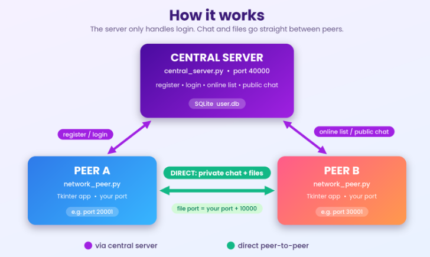
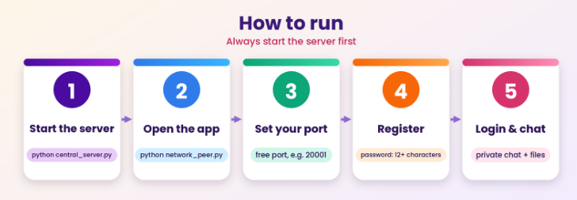

<p align="center">
  
  
  
  
  
</p>

# P2P Private Chat

A desktop chat application written in Python. A **central server** handles registration, login and the list of online users. After that, users chat and send files **directly to each other (peer-to-peer)**. The interface is built with Tkinter.

## Contents

- [Features](#features)
- [How it works](#how-it-works)
- [Quick start](#quick-start)
- [Requirements](#requirements)
- [How to run](#how-to-run)
- [Using the application](#using-the-application)
- [Rules and constraints](#rules-and-constraints)
- [Troubleshooting](#troubleshooting)
- [Project structure](#project-structure)
- [Security notes](#security-notes)

## Features

- User registration and login with a graphical interface
- Public chatroom (messages are broadcast to all online users)
- Private one-to-one chat after the other user accepts your chat request
- Direct file transfer between friends (the receiver must accept)
- Password-based login using salted PBKDF2-SHA256 and a one-time challenge (the plain password is never sent in a login request)
- Session tokens, login attempt limiting and automatic creation of the SQLite database

## How it works



| Part | File | Role |
|---|---|---|
| Central server | `central_server.py` | Registration, login, online user list, public chat broadcast |
| Peer (client) | `network_peer.py` | GUI, private chat, file transfer |
| Networking base | `base.py` | Socket handling and message framing |
| Database | `persistence.py` | SQLite access (`user.db`, created automatically) |
| Password helpers | `hash_function.py` | PBKDF2 hashing and login proof |

## Quick start

```bash
python -m pip install -r requirements.txt   # once
python central_server.py                    # terminal 1: start the server FIRST
python network_peer.py                      # terminal 2: start the app
```

Then: set a free port, click **Register** (password of 12+ characters), log in, and start chatting.

## Requirements

- Python **3.10 or newer** (Tkinter is included with the standard Windows installer)
- Pillow

```bash
python -m pip install -r requirements.txt
```

## How to run



> **Always start the central server first.** The app cannot register or log in until the server is running.

### Step 1: Start the central server

Open a terminal in the project folder:

```bash
python central_server.py
```

Keep this terminal open. The server listens on **port 40000** and creates `user.db` automatically on the first start.

### Step 2: Start the application

Open a **second** terminal in the same folder:

```bash
python network_peer.py
```

To test with several users on one computer, start `network_peer.py` again in a new terminal for each user and give each one a **different port**.

> By default the application looks for the central server on the **same computer** (port 40000). To run the server on another computer, change `server_info` in `NetworkPeer.__init__` in `network_peer.py` to that computer's IP address.

## Using the application

### 1. Start page (set your port)

1. Type a free port number.
2. Click **Register** if you are new, or **Login** if you already have an account.

### 2. Sign up page

<p align="center"></p>

1. Enter a username and a password.
2. Use **Show / Hide** to check your password.
3. Click the sign-up button. A message confirms success or tells you what to fix.
4. Go back to the login page and log in.

### 3. Login page

<p align="center"></p>

1. Enter your username and password.
2. Click **Login**. On success the chat page opens.
3. Use the sign-up link if you do not have an account yet.

### 4. Chat page

<p align="center"></p>

- Click the **reload** button to refresh the list of online users.
- Click an online user to send a **chat request**. When they accept, they appear in your friend list.
- Click a friend to open a private chat. Use the file button there to send a file.
- Open the **chatroom** for public messages.
- Use **logout** to leave properly (closing the window also logs you out).

## Rules and constraints

### Port (start page)

| Rule | Value |
|---|---|
| Allowed range | 1 to 65535 (recommended: **1024 to 55535**) |
| Must be free | Another program or another peer must not use it |
| File transfer port | Your port + 10000, so keep your port at 55535 or lower |
| Several users on one PC | Each one needs its own port |

### Sign up

| Field | Rule |
|---|---|
| Username length | 1 to 32 characters |
| Username characters | Letters, digits, `.`, `_`, `-` only (no spaces) |
| Username uniqueness | Must not already exist (case-sensitive, so `Ali` and `ali` are different) |
| Password length | **At least 12 characters** |
| Server must be running | Otherwise registration fails |

### Login

| Rule | Value |
|---|---|
| Username and password | Both are required |
| Wrong details | Shows one generic error (does not reveal which part was wrong) |
| Login limiting | After **5 failed attempts within 60 seconds**, further attempts from that address for that username are blocked for **60 seconds** |
| Challenge validity | The login challenge expires after **60 seconds** |
| One session per user | Logging in again replaces the previous session |

### Chat and files

| Item | Limit |
|---|---|
| Public message | Maximum 4096 characters |
| Network message size | Maximum 1 MB per message |
| Private chat | The other user must be online and must **accept** your request |
| File size | Maximum **100 MB** per file |
| File acceptance | The receiver must click **Yes** before the transfer starts |
| Received files | Saved in the `downloads/` folder with a random prefix in the name |
| File sender | Must be one of your friends (checked by IP address) |
| List size | Up to 99 online users and 99 friends are shown |

## Troubleshooting

| Problem | Solution |
|---|---|
| "Could not connect to the central server" | Start `central_server.py` first and check that port 40000 is free |
| "This port is unavailable or already in use" | Choose a different port |
| Cannot register: username error | Use only letters, digits, `.`, `_`, `-` (max 32) |
| Cannot register: password error | Use at least 12 characters |
| Login keeps failing | Wait 60 seconds if you entered a wrong password 5 times |
| Other users do not appear | Click the reload button, and make sure they are logged in |
| `ModuleNotFoundError: PIL` | Run `python -m pip install -r requirements.txt` |
| Windows firewall prompt | Allow Python on private networks so peers can connect |

## Project structure

```
p2p-private-chat/
├── central_server.py    # central server (run first)
├── network_peer.py      # GUI application (run second)
├── base.py              # socket + message framing
├── persistence.py       # SQLite database layer
├── hash_function.py     # password hashing helpers
├── asset.py             # loads GUI images
├── database_init.py     # optional manual database setup
├── image/               # GUI images
├── docs/images/         # README graphics (banner, diagrams)
├── requirements.txt
└── README.md
```git 

## Security notes

- This project is designed for a **trusted local network (LAN)**.
- Traffic is **not encrypted** (no TLS), so chat text can be read by someone on the same network. Do not use it over the internet without adding TLS.
- Do not commit `user.db`, the `downloads/` folder or any `.exe` files to GitHub (they are already listed in `.gitignore`).

## Author

**Arsal Arain**